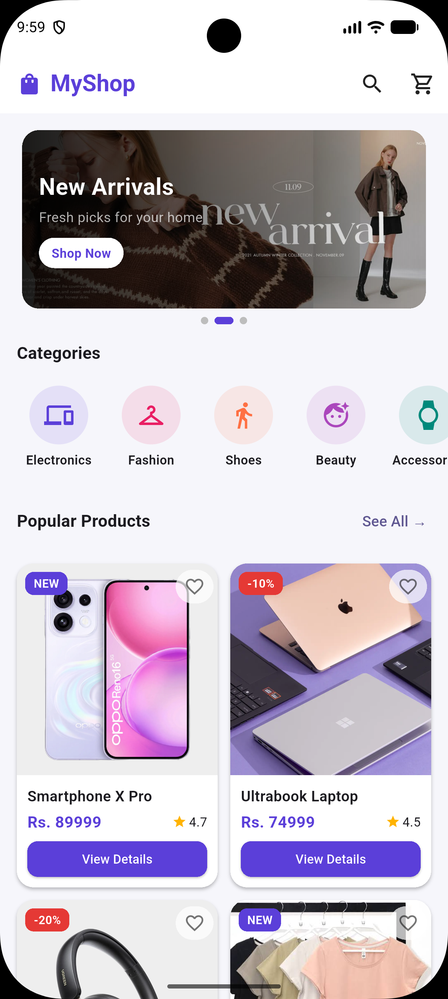
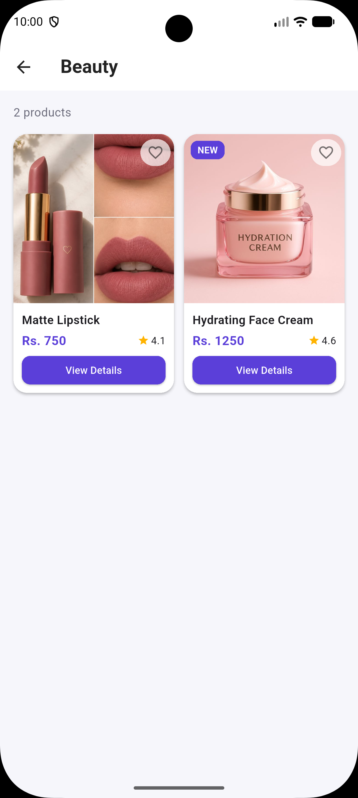
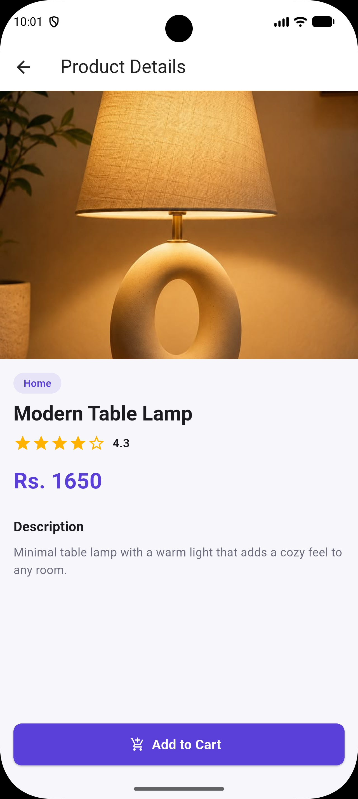

# MyShop - Mini E-Commerce App

**Student Name:** Supriya Shrestha   
**Mobile Application Development - Flutter**

## About the project

MyShop is a small shopping app I made in Flutter for our course assignment. You can look at the offers on the home page, scroll through the categories, open a category to see its products, and tap a product to see its full details.

## What the app does

- **Home page:** AppBar with the app name, a search icon and a cart icon. Below it there is a banner carousel, a row of categories and a "Popular Products" section with a "See All" button.
- **Carousel:** 3 banners that slide automatically. Tapping a banner opens the related category.
- **Categories:** 6 categories (Electronics, Fashion, Shoes, Beauty, Accessories, Home) in a row you can scroll sideways.
- **Product card:** I made one `ProductCard` widget and use it everywhere. It has the image, name, price, rating and a "View Details" button. A Stack puts a discount/NEW badge and a favourite heart on top of the image.
- **Category page:** shows the products of the selected category in a `GridView.builder`. The category name is passed from the home page.
- **Product details page:** shows the image, name, rating stars, price, category and description. The "Add to Cart" button only shows a SnackBar message ("Product added to cart") because a real cart was not required.
- 14 products in total, spread across the 6 categories.

Small extras I added: the heart icon toggles when you tap it, and the product image has a Hero animation when you open the details page.

## Screenshots

### Home Page


### Category Page


### Product Details


## Packages used

- [carousel_slider](https://pub.dev/packages/carousel_slider) (version 5.1.2)

I used this for the banner carousel on the home page. It takes care of the sliding, auto-play and the bigger centre banner, so I did not have to build a PageView by hand. I added it to `pubspec.yaml` and ran `flutter pub get`.

## Folder structure

```
lib/
  main.dart
  core/        app_theme.dart (colors, spacing, theme)
  data/        product_data.dart (products, categories, banners)
  models/      product.dart, category.dart, banner_item.dart
  screens/     home_page.dart, category_page.dart, product_details_page.dart
  widgets/     product_card.dart, product_grid.dart, category_item.dart,
               banner_carousel.dart, section_header.dart, network_image_box.dart
```

## How to run

1. Make sure Flutter is installed (`flutter doctor` should look fine).
2. Clone the repo:
```
   git clone https://github.com/supriyashrestha0o/Mini-eCommerce-Application.git
   cd Mini-eCommerce-Application
```
3. Install the packages:
```
   flutter pub get
```
4. Start an emulator or connect a phone, then run:
```
   flutter run
```